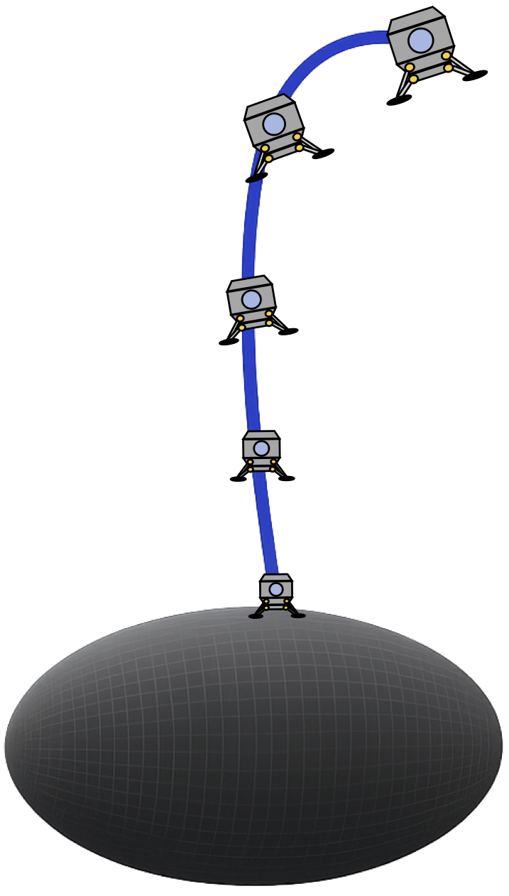
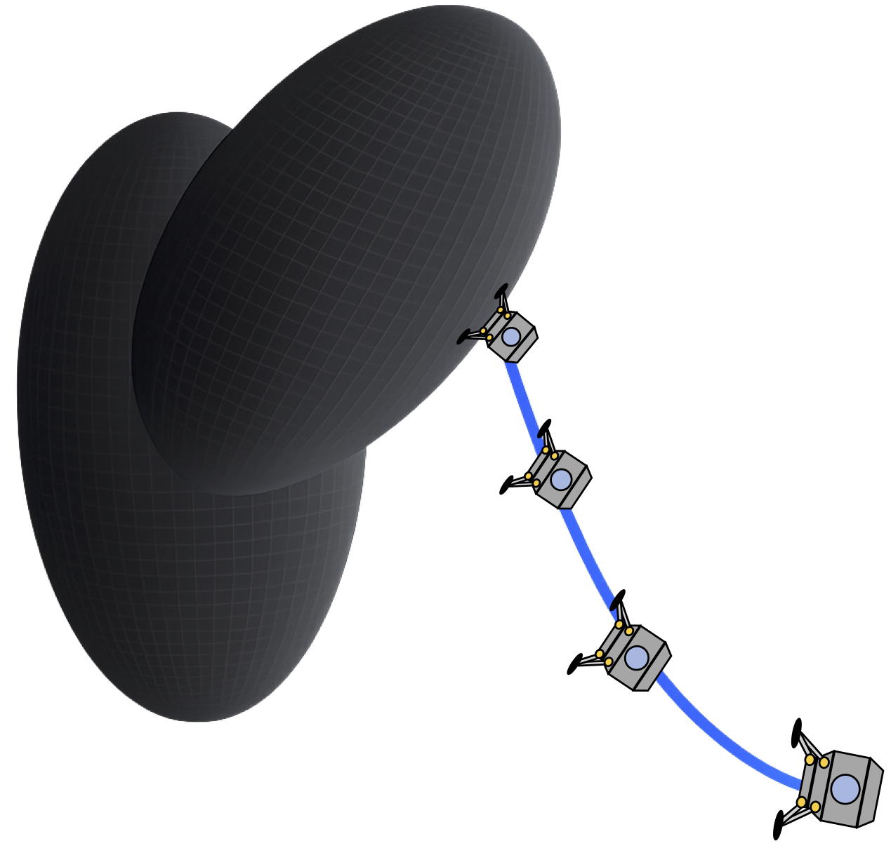
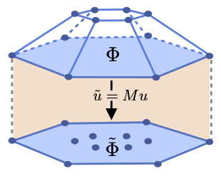
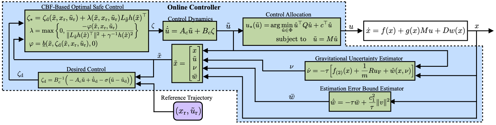

# Safe Position and Attitude Control for Landing on Small Celestial Bodies with Gravitational Uncertainty

This repository implements an optimal 6-DOF control framework designed for soft-landing maneuvers on Small Celestial Bodies (SCBs) under significant gravitational uncertainty.

Developed by: **Felipe Arenas-Uribe**  
Autonomy, Robotics and Controls Lab  
University of Kentucky  

<p align="center">
  
</p>

<p align="center">
  
</p>


## Features

The framework integrates the following core components:

- **Polytope-Based Constraint Mapping:** Maps high-dimensional actuator limits onto a lower-dimensional space of feasible forces and moments, allowing the controller to handle over-actuated spacecraft configurations seamlessly.

<p align="center">
  
</p>

- **Real-Time Disturbance Estimation:** Utilizes an Extended High-Gain Observer (EHGO) to estimate and compensate for unmodeled gravitational accelerations in real time.

- **6-DOF Trajectory Tracking:** Employs a feedback-linearizing nominal controller to track coupled translational and rotational trajectories simultaneously.

- **Safety-Critical Enforcement:** Employs a Minimum-Intervention Quadratic Program (QP) with Control Barrier Functions (CBFs) to strictly enforce state constraints and projected input limits.

- **Optimal Control Allocation:** Distributes the safety-filtered forces and moments back to individual actuators, ensuring the final commands remain within physical hardware limits.

<p align="center">
  
</p>

---

Control Barrier Functions require computing partial derivatives of multiple functions. To maintain flexibility and generality, this implementation uses **JAX automatic differentiation**. To ensure real-time performance we use JIT compilation and vectorization strategies to accelerate the repeated auto-diff process.

## Usage

### Requirements

- Python 3.8+
- JAX
- NumPy
- SciPy
- Matplotlib
- ARC_Grav

All dependencies can be installed via `pip`.

## Running the Examples

Four examples are included in this repository. We consider two spacecraft configurations: a robotic lander (conf_1) and a crewed landing module (conf_2).

Each spacecraft is tested in two different enviroments: an ellipsoidal asteroid and an irregularly-shaped asteroid. 

For each example we include the code to perform the trajectory generation and code to execute the landing maneuver.

**Generate a reference trajectory:**
```bash
python conf1_ellip_traj_gen.py
```

**Simulate landing maneuver:**
```bash
python ellip_conf1_SF.py
```


A `DEMO.py` file is also provided. You are encouraged to modify it to create your own asteroid model, spacecraft configuration, and landing mission.

You can learn more about generating custom asteroid gravity models using ARC_Grav here:
[https://github.com/FelipeArenasUribe/ARC-Grav](https://github.com/FelipeArenasUribe/ARC-Grav)

See the associated paper for details:
[https://arxiv.org/abs/2601.17628](https://arxiv.org/abs/2601.17628)


## Citation

If you find this work useful, please consider citing:

-- **[Safe Position and Attitude Control for Landing on Small Celestial Bodies with Gravitational Uncertainty](https://arxiv.org/abs/2610.04816)**

```bibtex
@misc{arenasuribe2026saferecedinghorizoncontrolfixedwing,
  title={Safe Receding-Horizon Control of Fixed-Wing Aircraft Using Constrained Approximate Dynamic Programming},
  author={Felipe Arenas-Uribe and Ricardo Gutierrez and Jesse B. Hoagg},
  year={2026},
  eprint={2610.06284},
  archivePrefix={arXiv},
  primaryClass={eess.SY},
  url={https://arxiv.org/abs/2610.06284}
}
```
